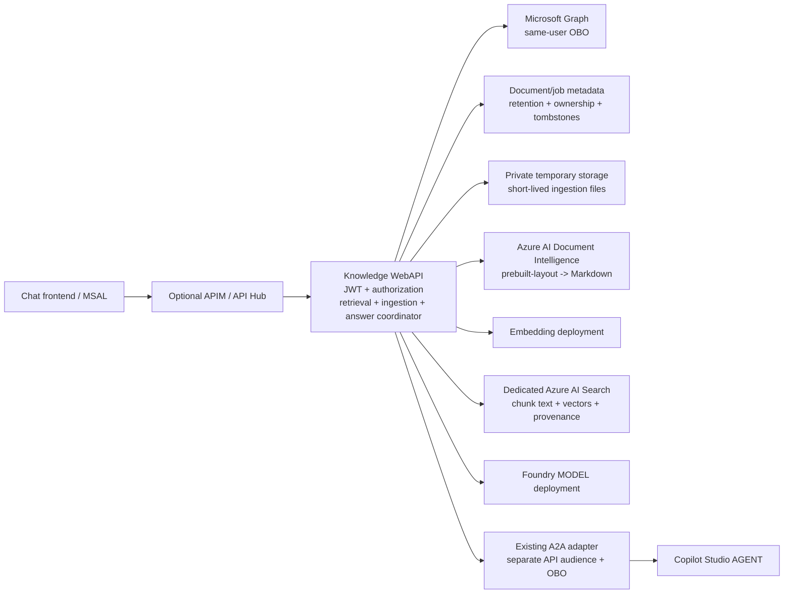

# Microsoft 365 grounding + app-owned RAG: implementation plan

Date: 2026-10-26

Status: proposed architecture, not an implemented feature or deployment approval.

Implementation note: an initial [Knowledge WebAPI](../src/FoundryCopilotA2A.KnowledgeApi/README.md)
now implements local upload, a delegated Graph picker, bounded live Graph context and
Responses API document RAG behind a chatbot toggle. For that implementation the selected
Document Intelligence model is **`prebuilt-read`**, not the layout model proposed below;
table reconstruction is therefore not promised. It uses bounded synchronous ingestion
and single-instance persistent metadata rather than the durable queue described in this
target architecture. Remaining production gates and exact limits are in the API guide.

## 1. Recommendation

Add an ASP.NET Core **Knowledge WebAPI** between the frontend and the answer provider.
It owns delegated Microsoft Graph retrieval, document ingestion, chunking, embedding calls,
Azure AI Search indexing, retrieval authorization, and citation assembly. For complex
documents (scanned PDFs, PDFs with tables or multi-column layouts), the WebAPI calls Azure
AI Document Intelligence's layout model to extract structured Markdown before chunking.

Offer two explicit answer paths:

1. **Foundry model + WebAPI orchestration**: preferred first implementation. The API
   retrieves evidence and invokes a configured model deployment directly. A model endpoint
   is not a Foundry agent endpoint and has no inherent access to Microsoft 365.
2. **Copilot Studio agent + WebAPI evidence**: reuse the existing adapter's delegated
   Copilot Studio integration. Start with a bounded evidence package passed to a deliberately
   configured agent; add a delegated retrieval tool only after its authentication and
   citation behavior are demonstrated end-to-end.

Use **Azure AI Search as a dedicated, private-to-the-application retrieval endpoint**.
"Local RAG" here means retrieval owned by this application, not Azure-free production or
a Foundry-managed file-search store. The WebAPI orchestrates chunking and calls an embedding
deployment; the numerical embedding computation happens at that deployment, not magically
inside the WebAPI process. Do not use Search indexers, integrated vectorization, or agent
file-search ingestion for this pipeline.

Include documents, mail, calendar, Teams, and people in the initial product scope, but
persist **only user-selected documents** in the RAG corpus. Query the other workloads live,
on behalf of the user, with explicit source toggles and bounded time ranges.

**This approximates Work IQ-like grounding; it does not reproduce Work IQ.** Graph exposes
workload APIs and search, not the complete Microsoft 365 Copilot intelligence, semantic
index, relationship inference, or cross-workload reasoning experience.

See [verified platform research](graph-workiq-rag-research.md) for primary-source citations,
API-specific permission details, and unresolved verification gates.
See [interactive visual mockups](graph-workiq-rag-mockups.html) for the proposed experience.

### Out of scope: licensed Copilot and Work IQ APIs

This design makes its own standard, delegated Microsoft Graph calls. It does **not** use
the Work IQ API, the Microsoft 365 Copilot Retrieval API, the Copilot Chat API, or any
other capability that requires a Microsoft 365 Copilot license or pay-as-you-go billing.

Consequences:

- No access to the Microsoft 365 Copilot semantic index. Relevance comes from standard
  Graph search/list operations, explicit date and source filters, and this application's
  own hybrid ranking in Azure AI Search.
- Cross-workload reasoning, entity resolution, and memory are application logic, not
  platform features. Expect lower recall on vague questions; the UI shows coverage gaps
  instead of implying an exhaustive tenant search.
- Costs are standard Graph throttling budgets, Azure AI Search, embedding, and model usage.
  No per-user Copilot license or Copilot Credits are consumed by this path.

## 2. Confirmed scope and proposed defaults

| Topic | Decision / proposal |
| --- | --- |
| Deliverable | Research, plan, standalone HTML mockups; no runtime changes |
| Retrieval store | Dedicated Azure AI Search service/index |
| Ingestion owner | WebAPI, including extraction routing, chunking, embedding requests, push indexing |
| Complex-document extraction | Azure AI Document Intelligence `prebuilt-layout` (Markdown output), called by the WebAPI |
| Microsoft 365 scope | SharePoint/OneDrive documents, mail, calendar, Teams, people |
| Import sources | Device upload and delegated SharePoint file picker |
| Answer providers | Foundry model deployment or Copilot Studio agent |
| Visual direction | Extend current chat's Segoe UI, neutral surfaces, amber actions, sidebar and citations |
| Document visibility | Proposed: tenant + importing user + conversation; no cross-user sharing initially |
| Activity persistence | Proposed: no mail, calendar, Teams, or people corpus; evidence is request-scoped |
| Retention | Proposed: 7-day document-copy TTL, configurable by approved policy; deletion sooner on request |
| Formats | Proposed RAG MVP: PDF (text-based or scanned), DOCX, TXT, Markdown, CSV |
| Upload limit | Proposed RAG MVP: 20 MiB decoded bytes and 300 pages per file; validate at browser, API, gateway |
| OCR / tables | Document Intelligence layout handles OCR, tables, headings and reading order; standalone image uploads stay out of the MVP |
| Tenant model | Single approved tenant initially; keys still include tenant ID |

These are new RAG product defaults, not claims about existing file-input support.
The current experimental attachment path remains separate and unchanged.

## 3. What exists in this repository

- The [adapter](../src/FoundryCopilotA2A.Adapter/Program.cs) already supplies JWT
  validation, provider routing, OBO, mock behavior, telemetry, and A2A transport.
- The [Foundry invoker](../src/FoundryCopilotA2A.Adapter/FoundryA2AInvoker.cs) calls a
  **Foundry A2A agent**, not a model deployment. Do not relabel it as direct model inference.
- The [chat frontend](../src/FoundryCopilotA2A.Chatbot/src/Chatbot.tsx) has conversation
  history, an experimental inline attachment picker, and the existing streaming client.
- The [shared browser client](../src/FoundryCopilotA2A.BrowserShared/a2aClient.ts)
  carries A2A responses and citation bundles. A new HTTP chat contract must be explicit;
  do not send arbitrary new bodies to existing A2A endpoints.
- The [authentication design](authentication-and-agent-scaling.md) already distinguishes
  resource audiences, gateway validation, adapter OBO, and provider-managed native delegation.
- The [CLI](../src/FoundryCopilotA2A.Cli/README.md) is the operational control plane.
  Extend it for permissions, consent, provisioning coordination, startup, smoke tests,
  and cleanup. Do not add operational shell scripts.

The existing native Foundry/Copilot Studio orchestration remains available. This proposal
adds an opt-in **application-grounded chat** entry path; it does not turn the adapter into
an invisible local multi-agent pipeline or silently change native A2A semantics.

## 4. Architecture and trust boundaries



### Identity design

Use one new confidential API registration for the independently deployed Knowledge API
and expose a delegated scope such as `access_as_user`. The SPA remains a public client
without credentials.

| Hop | Identity and enforcement |
| --- | --- |
| Browser -> Knowledge API | API-audience delegated token; validate issuer, tenant, audience, expiry, scope and caller policy |
| Optional APIM -> API | Transparent validation/forwarding, or explicit hub OBO; never change audiences accidentally |
| Knowledge API -> Graph | OBO using its incoming user assertion; separate Graph token; configured delegated grants |
| Knowledge API -> adapter | OBO to adapter's exposed delegated scope; adapter validates its own audience |
| Adapter -> Copilot Studio | Existing adapter OBO/provider authentication; preserve user isolation |
| Knowledge API -> Search / metadata / storage | API managed identity and narrowly scoped Azure RBAC |
| Knowledge API -> model / embeddings | API managed identity where supported, plus app authorization and deployment allowlist |
| Knowledge API -> Document Intelligence | API managed identity with `Cognitive Services User`; key (local) auth disabled on the resource |

The last row is an intentional difference from the current delegated Foundry **agent**
path: app-owned model inference can use a service identity after application authorization.
It does not authorize Graph access. Organizations requiring per-user inference authorization
must approve and test an alternative; do not assume the existing agent's token resource is
the correct resource for a model endpoint.

Never pass an API token directly to Graph or use a Graph token as the API's bearer token.
Never send delegated tokens, raw upload bytes, or search credentials to the model.
Use certificate or federated confidential-client credentials where supported; keep any
development secret out of source, URLs, frontend bundles, logs, and command lines.

Propagate claims challenges to the frontend using an explicit reauthentication response.
OBO cannot interactively show consent. Pre-grant reviewed delegated scopes and handle
Conditional Access, expired assertions, missing consent, and tenant policy failures.
In OBO the assertion's audience is the middle-tier API; the newly acquired token's
audience is the downstream resource. See the
[Microsoft Entra OBO specification](https://learn.microsoft.com/entra/identity-platform/v2-oauth2-on-behalf-of-flow).

### Why a separate API?

It gives ingestion its own request limits, deployment scaling, credentials, queue, metadata,
and lifecycle without mixing file processing into A2A handlers. The trade-off is one more
registration and an additional delegated hop for Copilot Studio. Keep retrieval logic
inside this API initially; do not create a separate microservice for each workload.

## 5. Microsoft 365 grounding model

Graph search is a discovery mechanism, not a complete content extraction or authorization
substitute. Follow hits with approved workload reads when full content is needed. Requests
must be allowlisted by workload and operation; the model must not supply arbitrary URLs,
mailbox IDs, OData filters, tenant IDs, or access scopes.

| Workload | Initial behavior | Persist? | Important boundary |
| --- | --- | --- | --- |
| SharePoint / OneDrive | Browse/search, select a file, reauthorize, download, ingest; optional live document discovery separately | Selected documents only | "Visible to user" does not mean unrestricted retention/export |
| Mail | Search current user's mailbox, read bounded relevant messages, omit attachments by default | No corpus | No shared/delegated mailbox support until separately designed |
| Calendar | Read current user's calendar view for bounded dates; preserve timezone and recurrence semantics | No corpus | It is a separate workload read, not assumed to be Graph Search event support |
| Teams | Supported delegated message search/read within user-accessible chats/channels | No corpus | Search, chat reads and channel reads have different scopes/consent requirements |
| People | Relevant people lookup; optional basic directory lookup only if justified | No corpus | Relevance is not an org chart, complete directory, or permission to read messages |

Use the research permission matrix as the source for exact Graph operations and scopes.
Do not request a blanket union of all possible Graph permissions. Maintain named
capabilities (documents, mail, calendar, Teams search, optional full Teams reads, people)
and expose their state in the UI. Directory enumeration and organization-wide Teams
exports are not prerequisites for this design.

For consent planning, delegated `Files.Read.All`, `Sites.Read.All`, `Mail.Read`,
`Calendars.Read`, and `Chat.Read` are distinct grants; `ChannelMessage.Read.All` adds
administrator-consent requirements for channel-message reads. A scope marked as not
requiring admin consent in the platform reference can still require administrator
approval under the tenant's consent policy. Application permission variants are a
different authorization model, not an acceptable automatic fallback for delegated failures.
Check each chosen operation against the
[Graph permissions reference](https://learn.microsoft.com/graph/permissions-reference)
and the operation-specific permission table.

### Query strategy

1. Authenticate, authorize conversation ownership, and validate selected capabilities.
2. Resolve relative dates using the user's timezone; ask for clarification for ambiguous
   dates or overly broad sensitive questions.
3. Search private document chunks using server-derived filters.
4. Fan out bounded live workload requests for enabled sources.
5. Fetch only necessary content; sanitize HTML, cap text size, preserve provenance.
6. Reauthorize candidate imported SharePoint documents and validate source version before
   reading their indexed text into the model context.
7. Normalize results into one evidence shape, deduplicate and rank within a bounded budget.
8. Generate with selected provider; validate citations against this turn's evidence set.
9. Stream answer plus coverage information. Distinguish denied, throttled, failed, empty,
   disabled, and unsupported sources.

Example proposed defaults: at most 8 evidence passages, a 6,000-token evidence budget,
and an explicit 30-day default activity window. Calendar questions such as "tomorrow"
override that window with the resolved day. These values require evaluation, not faith.

## 6. SharePoint picker and delegated import

**Recommend a custom Graph-backed picker for this app.** It fits the existing chat,
keeps Graph retrieval server-side under one reviewed delegated backend identity, and avoids
adding the official picker's separate SharePoint token/resource messaging contract.
This means implementing accessible browsing, search, pagination, and clear empty states.

The official Microsoft file picker is an alternative, not a wrapper around an arbitrary
Graph token. Its resource-specific authentication and permission requirements must be
implemented as documented if selected. Never hand an API token to it or trust arbitrary
origins in popup/message-channel authentication.

### Picker flow

1. User selects **Add documents -> Choose from SharePoint**.
2. Show the signed-in tenant and data-copy notice. Enable documents only after permission
   checks; route missing consent to the existing authentication recovery experience.
3. Offer configured/known sites and site search if approved. Do not promise enumeration
   of every site the user can access. Support drive/library navigation and file-name search.
4. The API follows Graph pagination internally or returns an opaque, integrity-protected
   continuation handle. Never accept caller-controlled Graph next-link URLs.
5. User selects files. Show name, type, size, location, and import count.
6. Browser posts only selected drive/item identifiers and target conversation.
7. API independently reads each item with OBO; enforces approved tenant, allowed location,
   file type, byte limit, classification policy, and conversation ownership.
8. Download the content server-side. Treat Graph's preauthenticated download location as
   sensitive and temporary; do not return or log it. Apply redirect/host policy rather than
   building a general remote-URL fetcher.
9. Create durable ingestion metadata; return a job handle. Show progress and per-file errors.
10. A document is searchable only after its complete version is committed.

Each imported copy is private to the importing user and conversation in the MVP. Selecting
a file does **not** grant other application users access or justify copying source ACLs.

## 7. WebAPI-owned ingestion and Search schema

```text
Device multipart upload OR authorized Graph download
  -> validation / byte limit / threat scanning
  -> private temporary file + durable metadata
  -> background ingestion job
  -> extraction router
       complex/scanned PDF (and optionally DOCX) -> Document Intelligence prebuilt-layout
       simple text PDF, TXT, Markdown, CSV       -> local parsers
  -> normalized Markdown + page/heading/table/row locators
  -> structure-aware deterministic chunking
  -> embedding endpoint (WebAPI makes the requests)
  -> batch push chunks + vectors into Azure AI Search
  -> commit document version as Ready
  -> remove temporary original according to retention policy
```

Use a durable job/queue mechanism owned by the WebAPI deployment and a small persistent
metadata store. Start with one implementation selected during build (for example Azure
Storage Queue + Tables); do not rely on an in-memory queue for production. An API worker
may perform processing, but it must support restart, retry, idempotency and lease recovery.
No tenant-wide crawler, SharePoint indexer, or Search skillset performs this ingestion.

Complete the authorized Graph download while a valid delegated request is available, then
queue an opaque reference to the private temporary file, never a user bearer token or
preauthenticated download URL. If import cannot complete that download within the request
budget, return a resumable state requiring the signed-in user rather than substituting
an app-only Graph credential. A later long-running delegated acquisition design needs a
supported encrypted token-cache/session strategy and claims-challenge recovery of its own.

### Document Intelligence extraction for complex documents

Local text extraction loses structure in PDFs with tables, multi-column layouts, headers
and footers, or scanned pages. For those, the WebAPI calls
[Azure AI Document Intelligence](https://learn.microsoft.com/azure/ai-services/document-intelligence/concept/retrieval-augmented-generation)
with the GA `prebuilt-layout` model (API version `2024-11-30`) and asks for **Markdown output**.
The layout model returns paragraphs, section headings, tables (as Markdown tables), reading
order, page numbers and spans, and includes OCR for scanned pages.

Document Intelligence only **extracts and structures** the content. The WebAPI still owns
chunking, embedding, indexing and authorization; no Search skillset or indexer is involved.

**Routing (the WebAPI decides; the caller cannot force a route):**

| Input | Route | Reason |
| --- | --- | --- |
| PDF with no usable text layer (scanned) | Document Intelligence | OCR is required |
| PDF where a cheap local probe detects tables, multiple columns or low text density | Document Intelligence | Keeps tables and reading order intact |
| Other text-based PDF | Local parser; Document Intelligence if local extraction fails quality checks | Saves cost and latency |
| DOCX | Local parser by default; Document Intelligence as a configurable option for table-heavy files | DOCX already carries structure |
| TXT, Markdown, CSV | Local parsers only | No layout analysis needed |

Make the route configurable per format (`Local`, `Auto`, `Always`) so a tenant can send every
PDF to Document Intelligence if consistency matters more than cost. Record the route in the
document's metadata for support and reprocessing.

**Calling the service:**

- Send the bytes from the private temporary file in the request body. Do not give the
  service a SAS URL or a Graph download URL.
- Authenticate with the API's managed identity (`Cognitive Services User` role). Disable key
  auth on the resource; never store a Document Intelligence key in configuration.
- Analysis is a long-running operation: submit, then poll the operation location with
  backoff that honors `Retry-After`. The poll state belongs to the durable ingestion job, so
  a worker restart resumes polling (or resubmits idempotently) instead of losing the job.
- Treat 429 and 5xx responses as retryable with bounded attempts. Treat an unsupported,
  encrypted or password-protected file as a terminal `NeedsAction` state.
- Delete the stored analysis result after the Markdown is read, if the API version supports
  it, and confirm the service's data-retention behavior during Phase 0.
- Place the resource in an approved region, and use a private endpoint where the WebAPI
  already uses private networking. Include it in data-processing approval: document
  content leaves the WebAPI for this service.
- Service limits (S0: up to 500 MB and 2,000 PDF pages per analysis) are well above the
  app's own 20 MiB / 300-page limit. The app limit, not the service limit, governs cost and
  latency. The free tier analyzes only the first two pages and is unsuitable beyond demos.

**Normalizing the output:** convert the result into one internal shape, whichever route
produced it: Markdown text plus a list of structural elements (heading path, paragraph,
table, page range, and source span). Strip page headers, footers and page numbers that the
layout model flags, so they do not repeat in every chunk. Figures stay as captions only in
the MVP; figure image extraction or description is a later decision.

**Mock mode:** add a deterministic fake extractor that returns fixed Markdown, including a
table, so the mock backend still runs with no Azure resources.

### Proposed chunking

- Chunk on structure first: split at Markdown headings, then paragraphs, then sentences.
  Prefix each chunk with its heading path (for example `Launch brief > Release gates`) so
  the chunk is understandable on its own.
- Keep a table in one chunk when it fits. When a table exceeds the chunk budget, split it
  by rows and **repeat the header row** in every part. Never split inside a row or cell.
  Store a `table` content kind and the table's page and row range as the locator.
- Keep a short caption or the preceding sentence with each table, because a bare table often
  lacks the context needed to retrieve it.
- CSV uses the same row-group rule with headers repeated. Do not split a large CSV as
  arbitrary character substrings.
- Start at 600-800 tokens/chunk with roughly 100-token overlap for prose; no overlap between
  table row groups (the repeated header provides context). Use tokenizer-aware boundaries.
- Store extractor (route, model ID, API version), chunker version, content hash, source
  version, and embedding deployment/model/dimension fingerprint.
- A retry of an identical document version is idempotent. A changed extractor route or
  model version, chunker, embedding model or vector dimension creates a controlled new
  version/index migration.
- Scanned files go through OCR. Files that are empty after OCR, unreadable, encrypted or
  rights-protected become explicit `NeedsAction` or `Failed` states, not successfully
  indexed empty content.
- Treat archive expansion, malformed PDFs and DOCX ZIP bombs as untrusted-file hazards.
  Validate and scan files before they are sent to Document Intelligence.

### Chunk fields

| Field | Purpose |
| --- | --- |
| `id` | Deterministic opaque Search key for tenant/user/conversation/document/version/chunk |
| `tenantId`, `ownerObjectId`, `conversationId` | Filterable server-enforced isolation |
| `documentId`, `documentVersion`, `chunkOrdinal` | Replacement, deduplication and deletion |
| `sourceKind`, `driveId`, `itemId` | Provenance and Graph reauthorization |
| `title`, `content`, `locator` | Search text and readable citation locations (page, heading path, table/row range) |
| `contentKind`, `headingPath`, `pageStart`, `pageEnd` | Prose vs table chunks, section context and page-accurate citations |
| `sourceWebUrl`, `sourceETag`, `retrievedAt` | Original link, source freshness, import time |
| `expiresAt`, `ingestionVersion` | Lifecycle and compatibility |
| `contentVector` | Fixed-dimension vector matching the configured embedding deployment |

Vector field configuration must match the actual deployment dimensions and similarity
metric. Validate this at startup; reject incompatible embeddings rather than truncating
or padding them. Search stores the chunks/vectors; application metadata stores job state,
ownership, tombstones, document manifest and committed version.
The
[Search push model](https://learn.microsoft.com/azure/search/search-what-is-data-import#pushing-data-to-an-index)
and [security-filter pattern](https://learn.microsoft.com/azure/search/search-security-trimming-for-azure-search)
support this division of responsibilities; custom-pushed content does not automatically
inherit SharePoint source permissions.

Use hybrid lexical + vector search. Add semantic reranking only if supported, enabled,
budgeted and shown to improve the evaluation set. The Search endpoint is never called
directly by the browser, and source filters are never accepted as trusted client input.

### Authorization and stale copies

- Derive `tenantId`, user ID, conversation and allowed document/version IDs from validated
  identity and metadata, not caller-supplied filter strings.
- Candidate search should return IDs/scores first, not unverified passage text to the model.
  Check ownership, expiry, tombstone and committed version, then reauthorize original
  SharePoint items. Fetch passage content only for allowed, unchanged versions.
- A source-version mismatch blocks the old copy and schedules reimport; do not cite old
  text as current just because the user can still read the file.
- Graph 403/404 blocks use. Graph failure/429 is not proof of access: fail closed for the
  affected source and show incomplete coverage.
- This is an authorization check at retrieval time, not instantaneous revocation of bytes
  already disclosed. No architecture can claw back earlier answers or screenshots.
- Recheck permissions for citation-content endpoints too. Do not expose raw index documents.
- On follow-up turns, rebuild evidence from currently authorized sources. Do not replay raw
  retrieved passages or old assistant summaries as newly authorized context. A stateful
  Copilot Studio conversation may already contain old evidence: rotate/reset that provider
  conversation when source access, membership, or expiry changes, and verify the agent's
  memory behavior before enabling this mode. A document-library filter cannot remove
  evidence already retained in an upstream agent's conversation.
- Do not use this copy-based design for files whose sensitivity/rights-management policy
  prohibits extraction, replication, or external processing. Confirm supported label and
  encrypted-content handling before enabling such libraries.

### Deletion and retention

Tombstone immediately in metadata so retrieval stops before asynchronous physical deletion.
Delete every chunk/version using the stored manifest; do not assume a Search TTL purges data.
Sweep expirations and orphaned versions; record cleanup failures for retry and operations.
Remove temporary originals separately. Document chat transcript and provider retention:
deleting an index entry does not erase material already quoted in previous chats.

## 8. Answer-provider contracts

### Foundry model endpoint

Build a new direct model client; do not modify the existing Foundry A2A invoker to pretend
it is a model client. Resolve a supported inference API/SDK and deployment from configuration.
The WebAPI owns retrieval, context construction, streaming and source mapping.

Use a provider-independent evidence envelope:

```text
EvidenceItem:
  evidenceId, sourceKind, title, locator, observedAt, excerpt, canonicalSourceReference

GroundedTurn:
  conversationId, userMessage, selectedSources, evidence[], coverage[], provider

GroundedAnswer:
  answerText, citationEvidenceIds[], coverage[], turnId
```

The envelope contains no credentials or unapproved arbitrary URLs. Treat excerpts as
untrusted data, not system instructions. Validate cited IDs against this turn's authorized
evidence. The server produces rendered URLs and locator text from stored provenance.
Do not claim grounding simply because the model emitted citation-looking brackets.

### Copilot Studio agent endpoint

Use the existing supported SDK/adapter route and a specially configured agent/topic for
application-grounded answers. Initial spike:

1. Submit a small, clearly delimited evidence package with the user question as ordinary
   agent input; do not assume a system-role override or undocumented attachment format.
2. Configure the agent to answer from that package for this mode, abstain when evidence is
   missing, and return stable evidence references.
3. Verify context limits, conversation carryover, streaming events, source attribution,
   duplicate-call avoidance, and isolation using a synthetic fact available only in evidence.
4. If the agent cannot reliably consume/return this contract, disable the mode with an
   explicit capability message. Do not silently send an ungrounded question instead.

A later alternative is an OAuth-authenticated WebAPI retrieval tool/custom connector.
The callback receives a token for the Knowledge API and separately obtains same-user Graph
access. Prove platform support for that exact connection identity and claims/consent flow;
a service credential or plain user-ID parameter is not equivalent.

Do not enable both pre-retrieval and callback retrieval by default: choose the orchestration
owner per mode to avoid duplicated searches, unpredictable data disclosure and cost.
Native Copilot Studio SharePoint knowledge is another product choice, not this app-owned
chunking/indexing pipeline.

## 9. Proposed HTTP surface

These routes are a design contract, not existing endpoints.

| Endpoint | Responsibility |
| --- | --- |
| `GET /api/knowledge/capabilities` | Provider and workload support/grant state without disclosing tokens |
| `GET /api/knowledge/sharepoint/sites` | Approved site discovery/search, bounded pagination |
| `GET /api/knowledge/sharepoint/drives` | Authorized libraries for a selected site |
| `GET /api/knowledge/sharepoint/items` | Authorized item listing/search; opaque continuation |
| `POST /api/knowledge/documents/upload` | Multipart bytes + authorized conversation; returns 202 + document/job IDs |
| `POST /api/knowledge/documents/import` | Drive/item references + authorized conversation; returns 202 |
| `GET /api/knowledge/jobs/{id}` | Owner-scoped per-file stage, error, counts and retry eligibility |
| `GET /api/knowledge/documents` | Owner/conversation-scoped source library |
| `DELETE /api/knowledge/documents/{id}` | Immediate logical block, queued physical cleanup |
| `POST /api/knowledge/chat/stream` | Explicit provider + source set + question; authorized evidence orchestration |
| `GET /api/knowledge/citations/{turnId}/{evidenceId}` | Reauthorized source metadata/link or permitted excerpt |

Use normal validation errors and Problem Details, with stable error codes, trace IDs,
retry hints and claims-challenge metadata where appropriate. Streaming must distinguish
`retrieval-progress`, `answer-delta`, `citations`, `coverage`, `completed` and `error`.
Choose a documented fetch-stream/SSE framing; do not imply it is standard A2A.

Reject an unsupported provider before ingestion/turn submission where possible.
Bind job/document/conversation IDs to the caller on every request. Use idempotency keys
for import and chat submission, request cancellation, bounded retries for safe Graph/Search
operations, and no blind retry of a potentially side-effectful Copilot Studio turn.

## 10. User experience and mockups

Open [the standalone HTML prototype](graph-workiq-rag-mockups.html) in a browser.
It has no dependencies, network requests, Azure credentials, or persistence. Its examples
are synthetic and every mutation is labeled as a preview.

| Mockup screen | Interaction and intended behavior |
| --- | --- |
| Chat & evidence | Select answer provider and workload sources; show cited answer, source location and coverage |
| Add documents | Choose device upload or SharePoint; explain indexing rather than direct provider attachment |
| SharePoint picker | Site/library context, filterable file list, multiple selection, copy notice, import action |
| Source library | Ready, Embedding, NeedsAction and Blocked states; remove a source and explain retained transcripts |
| Access & recovery | Sign-in, administrator consent, revoked access, throttling and no-evidence recovery |

The upload control previews a filename only; it does not read the file. The ingestion
button switches to a fixture completion state rather than simulating real parsing.
The picker is a **custom picker concept**, not a screenshot or implementation of
Microsoft's official file picker.

### Required production states

- Signed out; sign-in in progress; tenant mismatch; consent missing; admin approval needed.
- Workload unsupported or unavailable to the user (for example, no mailbox or Teams);
  source disabled by user or policy.
- Picker loading, empty, pagination, no matches, 403, 404, throttling and stale selection.
- File invalid, oversized, infected, encrypted, unextractable, queued, scanning,
  analyzing layout, extracting, chunking, embedding, indexing, Ready, failed and cancelled.
- Revoked/expired/replaced source; cleanup pending/failed.
- Chat retrieval underway; partial coverage; no evidence; generation failed; cancelled;
  provider unavailable; unknown citation rejected.

On narrow screens the sidebar becomes a horizontal screen selector; evidence moves below
the answer. Production screen/dialog transitions preserve focus, file inputs have visible
labels, all actions work by keyboard, and progress/errors are announced without excessive
live-region noise. Source selection never pretends to grant consent.

## 11. Delivery sequence and acceptance gates

All phases are part of the initial scope; documents-first is an implementation sequence,
not a decision to omit the requested activity workloads.

### Phase 0: validate platform choices and policy

- Confirm Graph operations and delegated scopes against the research matrix and tenant
  policy; enable the smallest named capabilities.
- Confirm target tenant, site discovery expectations, supported Teams message operations,
  and which scopes require admin consent.
- Confirm every selected Graph operation works with standard delegated permissions and
  no Microsoft 365 Copilot license or pay-as-you-go setup.
- Approve document copying, classification restrictions, retention, regional processing,
  provider storage policies, and private-user corpus semantics.
- Prove one OBO Graph read, one model inference, one embedding, one Document Intelligence
  layout analysis of a synthetic table-heavy PDF, and the Copilot Studio evidence/citation
  spike using synthetic content.

**Gate:** no claim of provider parity or tenant readiness until the exact endpoint
and permissions have been demonstrated.

### Phase 1: secure API + mock vertical slice

- Add proposed `src/FoundryCopilotA2A.KnowledgeApi` using existing service defaults,
  configuration, JWT validation conventions and structured errors.
- Add deterministic mock Graph/search/extraction/embedding/generation implementations. Mock mode has
  no Azure dependency and does not silently substitute fixtures on live-backend failures.
- Define HTTP/evidence contracts and owner-scoped metadata. Add opt-in grounded-chat mode
  to both browser entry points with shared source/citation types.
- Plan resource wiring in the existing AppHost without starting a second ad-hoc stack.
- Extend the CLI with proposed capability/consent diagnostics and synthetic smoke commands;
  names are selected during implementation and documented then.

**Gate:** frontend -> API -> mock retrieval -> mock provider -> valid citations works
without Azure; legacy A2A text/attachments still pass.

### Phase 2: document ingestion + SharePoint

- Implement durable jobs, the extraction router, Document Intelligence layout calls,
  structure-aware chunking, embedding calls, Search push indexing,
  committed versions, tombstones and retention.
- Wire device upload and delegated custom picker into the same ingestion workflow.
- Implement request-time original-item authorization and version checks.

**Gate:** a synthetic fact from device and SharePoint imports is answered correctly with
its real locator, including a value that exists only inside a table of a scanned PDF;
revoked, changed, deleted, or cross-user files never enter the model.

### Phase 3: live Microsoft 365 activity

- Add mail, calendar, Teams, people with independent source adapters and capability states.
- Implement dates/timezones, pagination, query budgets, source HTML sanitization, provenance,
  partial coverage and service-specific retry rules.
- Keep activity evidence transient; redact sensitive text from operational telemetry.

**Gate:** demonstrate each enabled workload with synthetic authorized fixtures and live
tenant tests where permitted; demonstrate explicit admin-consent and throttling paths.

### Phase 4: provider integration and evaluation

- Enable the direct Foundry model mode after source contract tests pass.
- Enable Copilot Studio only if the evidence-ingestion, source-isolation and citation
  acceptance spike passes for the actual agent configuration.
- Evaluate relevance, citation correctness, groundedness, refusal, prompt injection,
  cross-user leakage and multi-source questions.
- Retain the existing native agent mode as a separate capability.

**Gate:** no fallback from failed authorization/retrieval to a success-shaped ungrounded
answer; no synthesized source links; no repeated agent call after ambiguous failure.

### Phase 5: hardening and rollout

- Add infrastructure under the existing infrastructure convention, identities/RBAC,
  secretless configuration where supported, private networking where required and alerts.
- Add upload/rate quotas, job backpressure, chunk/input budgets and spend dashboards.
- Document CLI operations for setup, consent, endpoint verification, cleanup and recovery.
- Roll out behind a feature flag, first to an approved test group.

**Gate:** deletion/expiry/orphan cleanup and restart recovery work; legacy routes remain
unchanged when grounded-chat mode is off.

## 12. Test and evaluation matrix

| Area | Exact assertion |
| --- | --- |
| Audience | Graph bearer rejected by API; API bearer never sent as Graph token; adapter gets its own audience |
| Tenant/user isolation | User B and tenant B cannot list, search, poll, cite, delete or infer user A's documents/jobs |
| Conversation isolation | Caller cannot bind an import, citation or job to an unowned conversation |
| Delegation | Missing consent and claims challenge produce recoverable states; no app-only Graph substitution |
| Picker | Tampered drive/item/continuation rejected; expired selection rechecked; pagination does not skip imports |
| Upload | Zero bytes, over 20 MiB or 300 pages, deceptive MIME/extension, malformed DOCX/PDF, password-protected PDF and malware rejected or blocked |
| Extraction | Routing picks Document Intelligence for scanned and table-heavy PDFs; caller cannot force a route; 429/5xx retried with Retry-After; worker restart resumes a pending analysis; mock extractor needs no Azure |
| Chunks | Stable IDs, preserved locator, correct tokenizer bounds, repeated import deduplicates, CSV headers preserved |
| Tables | Small tables stay whole; large tables split by rows with the header repeated; no split inside a row; page and row range in citations; table-only facts retrievable |
| Embeddings | Dimension mismatch fails visibly; wrong deployment/index fingerprint blocks startup or ingestion |
| Jobs | Crash mid-embedding/indexing recovers; only fully committed version searchable; retry does not duplicate |
| Revocation | After Graph denies access, no old chunk text or snippet enters the model or citation response |
| Freshness | Changed source version blocks old content until reimport commits |
| Deletion | Tombstone excludes immediately; all stored version keys removed; failures remain observable/retryable |
| Activity | Pagination, recurrence/timezone, 403, 404, 429 + Retry-After, timeout, no results and disabled source distinguished |
| Citations | Every displayed citation maps to authorized evidence from the same turn; invented IDs rejected |
| Prompt injection | Document/mail instructions cannot override system rules, select arbitrary tools or disclose other sources |
| Provider parity | Unique synthetic fact survives each provider; unsupported provider stays disabled |
| Browser | Desktop/mobile flows, keyboard focus, announced errors, cancellation and account switching |
| Regression | Existing A2A protocol versions, attachment validation, citations, idempotency, OBO and native orchestration unchanged |

Before rollout, build a synthetic multi-workload evaluation set and set quality/performance
thresholds with the product owner. Suggested starting release targets (not measured results):
100% citation-ID validity and isolation tests, at least 90% answerable-fact retrieval within
the top 8 passages on the curated document set, and no unsupported factual answer on the
no-evidence cases. Measure retrieval latency, time to first answer token, cost/turn,
embedding cost/import and p95 ingestion time at the approved file-size limit.

## 13. Decisions still requiring approval before implementation

1. Private per-user/per-conversation documents versus shared workspaces. Shared corpora need
   a separately designed ACL synchronization and revocation model.
2. Exact delegated permission set and Teams search-only versus expanded full-message reads.
3. Allowed sites, sensitivity labels, copy/export policies and treatment of encrypted files.
4. Retention for source copies, temporary originals, evidence and chat transcripts.
5. Copilot Studio evidence contract versus delegated retrieval tool, based on spike results.
6. Approved model/embedding deployments, regions, dimensions, spend limits and latency targets.
7. Document Intelligence region, networking, routing default (`Auto` versus `Always` for
   PDF), per-user page quotas, and approval to send document content to the service.
8. Exact persistent job/metadata technology and production deployment scale.

No Azure resources, app registrations, delegated grants, or environment-specific identifiers
are created by this plan or its mockups.

## 14. Deliverable validation

The standalone prototype was opened in the browser and checked at 1440 px and 390 px:
all five screens render without page-width overflow; screen changes move focus to the
heading; empty search disables import; import, completion and deletion previews expose
their intended states. No browser JavaScript errors were observed in those checks.
Desktop chat and mobile picker were visually inspected. The mockup script parses, has no
external assets or network calls, and the design detector reported no findings.

These checks validate a design artifact only. No live Graph, Search, embedding, model,
or Copilot Studio integration was tested or implied.
